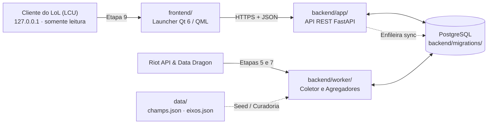

# Estrutura de Pastas — Projeto LÍDER

Este documento descreve a **organização atual** do repositório `Lider` e a **estrutura planejada** ao longo das etapas descritas em [etapas.md](etapas.md) e [ARQUITETURA.md](ARQUITETURA.md).

Legenda de status:
- `[Atual]` — já existe no repositório.
- `[Etapa N]` — planejado para ser adicionado na etapa correspondente.

---

## 1. Visão Geral do Monorepo

```text
Lider/
├── frontend/                   # [Atual] Launcher desktop em C++17 + Qt 6 (Qt Quick/QML)
├── backend/                    # [Atual] API REST (FastAPI + PostgreSQL) e futuro worker
│   ├── app/                    # [Atual - Etapa 2] Aplicação FastAPI (rotas, auth, serviços)
│   ├── migrations/             # [Atual - Etapa 2] Scripts SQL versionados do PostgreSQL
│   ├── scripts/                # [Atual - Etapa 2] Utilitários operacionais (migrate, imports)
│   ├── tests/                  # [Atual - Etapa 2] Testes automatizados (unitários + integração)
│   ├── storage/                # [Etapa 4] Armazenamento local de logos (dev) / camada abstrata S3/R2
│   └── worker/                 # [Etapa 5] Processo separado: coleta Riot API, agregações e jobs
├── data/                       # [Atual] Dados estáticos de referência (campeões, eixos/tags)
├── docs/                       # [Atual] Documentação de arquitetura, roadmap e estrutura
├── build/                      # [Ignorado no Git] Artefatos de compilação CMake/Ninja do launcher
├── .gitignore                  # [Atual] Regras de arquivos ignorados
└── README.md                   # [Atual] Guia de compilação e execução do launcher
```

> **Regra de ouro de fronteiras:** o `frontend/` **nunca** acessa o PostgreSQL nem a Riot API diretamente. Toda comunicação externa passa por HTTPS + JSON via `backend/app/`, que por sua vez isola segredos (senha do banco, `JWT_SECRET`, chave da Riot API). A única comunicação local do launcher é com o cliente do League of Legends (`127.0.0.1`, somente leitura via LCU na Etapa 9).

---

## 2. Fluxo entre Camadas



---

## 3. Detalhamento por Diretório

### 3.1 `frontend/` — Launcher Desktop (Qt 6 / QML + C++17)

```text
frontend/
├── CMakeLists.txt                       # [Atual] Build CMake/Ninja (adicionar Qt6::Network na Etapa 3 e Qt6::WebSockets na Etapa 9)
├── resources/
│   └── mock/                            # [Atual] JSONs de contrato da API (usados pelo MockBackendService)
│       ├── analysis.json                # Contrato de GET /teams/{id}/analysis
│       ├── draft.json                   # Contrato de GET /draft/catalog
│       ├── players.json                 # Contrato de GET /teams/{id}/players/{puuid}
│       ├── teams.json                   # Contrato de GET /teams
│       └── training.json                # Contrato de GET /teams/{id}/training
├── src/
│   ├── main.cpp                         # [Atual] Composition root (escolhe Mock / Routed / Http e LCU)
│   ├── core/                            # [Atual] Contratos assíncronos desacoplados da implementação
│   │   ├── IBackendService.h            # Interface de comunicação com a API
│   │   └── ILcuBridge.h                 # Interface da ponte local com o cliente do LoL
│   ├── services/                        # Implementações concretas dos contratos
│   │   ├── MockBackendService.{h,cpp}   # [Atual] Implementação simulada local
│   │   ├── MockLcuBridge.{h,cpp}        # [Atual] Simulador de eventos do cliente do LoL
│   │   ├── HttpBackendService.{h,cpp}   # [Atual - Etapa 3] Cliente HTTP/HTTPS (QNetworkAccessManager + JWT + refresh; upload na Etapa 4)
│   │   ├── RoutedBackendService.{h,cpp} # [Atual - Etapa 3] Roteador por endpoint entre HttpBackendService e MockBackendService
│   │   ├── TokenStore.{h,cpp}           # [Atual - Etapa 3] Armazenamento seguro do refresh token no cofre do SO (Windows Credential Manager)
│   │   ├── LcuBridge.{h,cpp}            # [Etapa 9] Conexão real HTTPS/WSS somente leitura com LeagueClientUx
│   │   └── LcuTranslator.{h,cpp}        # [Etapa 9] Função pura de tradução JSON LCU -> modelo do DraftController
│   └── viewmodels/                      # [Atual] Controllers C++ expostos ao QML (estado + validação UX)
│       ├── BaseController.h             # Estado base (loading, error)
│       ├── AppController.{h,cpp}        # Sessão, perfil, times, navegação e status LCU
│       ├── AnalysisController.{h,cpp}   # Análise do time e perfil individual do jogador
│       ├── DraftController.{h,cpp}      # Draft ao vivo/manual, simulação, debounce e sequência (seq)
│       └── TrainingController.{h,cpp}   # Diagnósticos, metas e evolução
└── qml/
    ├── Main.qml                         # [Atual] Janela raiz sem moldura + fluxo Login -> Shell
    ├── Shell.qml                        # [Atual] Layout principal (TitleBar + Sidebar + Loader de páginas)
    ├── theme/                           # [Atual] Design tokens, ícones e tabela de rotas
    │   ├── Theme.qml
    │   ├── Icons.qml
    │   └── Routes.qml
    ├── components/                      # [Atual] Design system customizado (estilo Basic, sem shaders pesados)
    │   ├── AlertRow.qml                 ├── NeonTabBar.qml
    │   ├── Avatar.qml                   ├── NeonTextField.qml
    │   ├── BarRow.qml                   ├── PageHeader.qml
    │   ├── ChampionIcon.qml             ├── RadarChart.qml
    │   ├── ConfidenceRing.qml           ├── RankList.qml
    │   ├── DataTable.qml                ├── ResizeHandles.qml
    │   ├── EmptyState.qml               ├── ScrollPage.qml
    │   ├── LcuStatusBadge.qml           ├── Sidebar.qml
    │   ├── LoadingBar.qml               ├── SidebarItem.qml
    │   ├── NeonButton.qml               ├── Sparkline.qml
    │   ├── NeonCard.qml                 ├── StatCard.qml
    │   ├── NeonPopup.qml                ├── TeamHeader.qml
    │   ├── TitleBar.qml                 └── Toast.qml
    ├── dialogs/                         # [Atual] Modais reutilizáveis
    │   ├── ChampionPicker.qml
    │   ├── ConfirmDialog.qml
    │   ├── ProfileDialog.qml
    │   ├── TeamEditorDialog.qml
    │   └── GoalEditorDialog.qml         # [Etapa 10] Criação/edição de metas de treino
    └── pages/                           # [Atual] Telas carregadas sob demanda via Loader
        ├── LoginPage.qml
        ├── NoTeamPage.qml
        ├── TeamsPage.qml
        ├── AnalysisPage.qml
        ├── analysis/
        │   ├── ElencoTab.qml
        │   ├── GeneralTab.qml
        │   ├── PlayerDetail.qml
        │   ├── RecordsTab.qml
        │   └── StatsTab.qml
        ├── DraftCompositionPage.qml
        ├── DraftArchetypesPage.qml
        ├── DraftCountersPage.qml
        ├── DraftSimulationPage.qml
        ├── TrainingDiagnosticPage.qml
        ├── TrainingGoalsPage.qml
        └── AboutDiagnosticsPage.qml     # [Etapas 9/11] Aviso legal Riot, LGPL Qt e diagnóstico LCU
```

---

### 3.2 `backend/` — API REST (FastAPI + PostgreSQL)

```text
backend/
├── docker-compose.yml            # [Atual - Etapa 2] PostgreSQL 16 local (bancos lider e lider_test)
├── .env.example                  # [Atual - Etapa 2] Variáveis de ambiente documentadas
├── requirements.txt              # [Atual - Etapa 2] Dependências Python (FastAPI, Uvicorn, asyncpg, Argon2, PyJWT, httpx, pytest)
├── pyproject.toml                # [Atual - Etapa 2] Configuração de testes (pytest)
├── README.md                     # [Atual - Etapa 2] Como subir banco, rodar migrações, iniciar API e testar
├── app/
│   ├── __init__.py               # [Atual - Etapa 2]
│   ├── main.py                   # [Atual - Etapa 2] App FastAPI, lifespan do pool, handlers de erro {"message": "..."}
│   ├── config.py                 # [Atual - Etapa 2] Carregamento tipado de configurações (.env)
│   ├── db.py                     # [Atual - Etapa 2] Pool assíncrono PostgreSQL (asyncpg) e transações
│   ├── security.py               # [Atual - Etapa 2] Hash Argon2id (tempo constante), JWT acesso, hash SHA-256 refresh token
│   ├── deps.py                   # [Atual - Etapa 2] Dependências FastAPI (db, usuário autenticado, RiotClient)
│   ├── schemas.py                # [Atual - Etapa 2] Modelos Pydantic de entrada/saída compatíveis com resources/mock/
│   ├── routers/                  # Rotas HTTP finas (validação + delegação para services)
│   │   ├── __init__.py           # [Atual - Etapa 2]
│   │   ├── auth.py               # [Atual - Etapa 2] POST /auth/register, /auth/login, /auth/refresh, /auth/logout
│   │   ├── me.py                 # [Atual - Etapa 2] GET /me, PUT /me/riot-account, PUT /me/active-team
│   │   ├── teams.py              # [Atual - Etapa 2] GET/POST /teams, PUT/DELETE /teams/{id} (+ logo na Etapa 4)
│   │   ├── sync.py               # [Etapa 5] POST /teams/{id}/sync, GET /teams/{id}/sync/status
│   │   ├── analysis.py           # [Etapa 6] GET /teams/{id}/analysis, GET /teams/{id}/players/{puuid}
│   │   ├── draft.py              # [Etapa 7] GET /draft/catalog, POST /teams/{id}/draft/analyze
│   │   ├── training.py           # [Etapa 10] GET /teams/{id}/training, CRUD /teams/{id}/goals
│   │   └── config.py             # [Etapa 11] GET /client/config (versão mínima, canal, interruptores remotos)
│   └── services/                 # Regras de negócio e consultas SQL parametrizadas
│       ├── __init__.py           # [Atual - Etapa 2]
│       ├── riot_client.py        # [Atual - Etapa 2] Resolução Nick#Tag -> PUUID (modos fake e real)
│       ├── auth_service.py       # [Atual - Etapa 2] Cadastro, login, rotação de refresh token, vínculo Riot
│       ├── team_service.py       # [Atual - Etapa 2] CRUD de times, isolamento por dono, deduplicação e ordem
│       ├── logo_service.py       # [Etapa 4] Validação real Pillow, recodificação WebP 512px com preenchimento
│       ├── storage_service.py    # [Etapa 4] Abstração de armazenamento (pasta local em dev -> S3/R2 em prod)
│       ├── analysis_service.py   # [Etapa 6] Leitura de instantâneos de análise por período e jogador
│       ├── draft_engine.py       # [Etapa 7] Função pura de classificação de composição, regras e sugestões
│       └── training_service.py   # [Etapa 10] Diagnósticos, metas sustentadas e evolução
├── storage/                      # [Etapa 4] Armazenamento local em dev (ignorado no Git)
│   └── logos/                    # Arquivos <uuid>.webp servidos em desenvolvimento
├── migrations/                   # Scripts SQL versionados aplicados em ordem numérica
│   ├── 001_init.sql              # [Atual - Etapa 2] Esquema inicial corrigido (usuarios, atletas, refresh_tokens, times, time_membros, campeoes, partidas)
│   ├── 002_collector_and_summaries.sql  # [Etapas 5/6] Fila de tarefas, marca d'água, objetivos/bans, membros por partida, instantâneos
│   └── 003_training.sql          # [Etapa 10] Referências por função/elo, regras de diagnóstico, metas e histórico de progresso
├── scripts/
│   ├── migrate.py                # [Atual - Etapa 2] Executor idempotente de migrações SQL com tabela schema_migrations
│   ├── sync_ddragon.py           # [Etapa 7] Sincronização manual/agendada do catálogo Data Dragon
│   └── import_champion_tags.py   # [Etapa 7] Validação e carga da planilha/JSON de características dos campeões
├── worker/                       # [Etapa 5] Processo separado da API (reaproveita app/config.py e app/db.py)
│   ├── __init__.py
│   ├── main.py                   # Loop principal do worker + encerramento gracioso
│   ├── queue.py                  # Fila transacional no PostgreSQL (SELECT ... FOR UPDATE SKIP LOCKED)
│   ├── rate_limiter.py           # Controle de janelas curta/longa por região + tratamento de 429 Retry-After
│   ├── riot_api.py               # Cliente completo da Riot API (account-v1, match-v5, timeline, summoner-v4, league-v4)
│   ├── scheduler.py              # Agendador periódico de times atrasados e atualização de Data Dragon/elos
│   ├── processors/               # Ingestão idempotente de partidas e timelines
│   │   ├── match_processor.py
│   │   └── timeline_processor.py
│   └── aggregators/              # Recálculo de instantâneos após sincronização
│       ├── team_analysis.py      # [Etapa 6] Indicadores, sinergias, matchups, recordes, comebacks/throws
│       ├── player_stats.py       # [Etapa 6] Estatísticas individuais e solo vs. equipe
│       └── training_engine.py    # [Etapa 10] Motor de regras de diagnóstico, metas e séries de evolução
└── tests/                        # [Atual - Etapa 2] Suíte automatizada (pytest + httpx)
    ├── conftest.py               # Fixtures de banco de teste isolado (TEST_DATABASE_URL) e cliente HTTP
    ├── test_security_unit.py     # Testes unitários sem banco (Argon2id, JWT, Riot fake, validações)
    ├── test_auth.py              # Integração: cadastro, login, refresh uso único, reuso, logout, /me, vínculo Riot
    ├── test_teams.py             # Integração: CRUD times, time ativo, isolamento entre donos, regras de membros
    ├── test_logos.py             # [Etapa 4] Upload, validações maliciosas, troca e limpeza
    ├── test_worker.py            # [Etapa 5] Respostas gravadas, servidor falso Riot (429/5xx), idempotência
    ├── test_analysis.py          # [Etapa 6] Banco sintético com cálculos conferidos à mão
    ├── test_draft_engine.py      # [Etapa 7] Casos de referência, propriedades e bordas do motor
    └── test_training.py          # [Etapa 10] Métricas, regras, metas sustentadas e coerência
```

---

### 3.3 `data/` — Dados Estáticos e Curadoria de Domínio

```text
data/
├── champs.json                   # [Atual] Base de campeões para referência e preparação do catálogo
├── eixos.json                    # [Atual] Definição de eixos/dimensões táticas do draft
├── champion_tags.csv             # [Etapa 7] Planilha versionada e curada (campeão, rotas, pesos 1..5 por dimensão)
└── training_benchmarks.json      # [Etapa 10] Referências estáticas versionadas por métrica, função e elo
```

---

### 3.4 `docs/` — Documentação do Projeto

```text
docs/
├── ARQUITETURA.md                # [Atual] Arquitetura do launcher Qt/QML, contratos e rastreabilidade de requisitos
├── etapas.md                     # [Atual] Plano detalhado das etapas 1 a 12 e decisões de produto/política Riot
└── estrutura_pastas.md           # [Atual] Este documento (organização atual e planejada do monorepo)
```

---

## 4. Resumo de Responsabilidades por Pasta

| Pasta | Responsabilidade Principal | O que **não** deve ficar lá |
|---|---|---|
| `frontend/qml/` | Telas, componentes visuais, navegação e animações | Lógica de rede, acesso a tokens, regras de negócio críticas |
| `frontend/src/viewmodels/` | Estado das telas e validações rápidas de UX | Consultas HTTP diretas ou detalhes do protocolo LCU |
| `frontend/src/services/` | Implementações de rede (`Http*`, `Mock*`) e ponte `LCU` | Segredos do servidor (senha do banco, chave da Riot) |
| `backend/app/routers/` | Definição de rotas HTTP, status codes e serialização | SQL complexo inline ou lógica pesada de negócio |
| `backend/app/services/` | Regras de negócio, validação real, isolamento por dono e SQL | Coleta longa da Riot API ou agregações em lote síncronas |
| `backend/worker/` | Coleta assíncrona da Riot, rate limiting e recálculo de instantâneos | Servir requisições HTTP diretamente ao launcher |
| `backend/migrations/` | Evolução versionada e reprodutível do esquema PostgreSQL | Dados sensíveis ou dumps de produção |
| `data/` | Catálogos e tabelas curadas versionadas no Git | Arquivos gerados em tempo de execução ou cache de usuário |

---

## 5. Mapa de Evolução por Etapa

| Etapa | Pastas / Arquivos Principais Impactados | Estado |
|---|---|---|
| **1 — Frontend com mock** | `frontend/` | Concluída |
| **2 — API Login e Times** | `backend/app/`, `backend/migrations/001_init.sql`, `backend/scripts/migrate.py`, `backend/tests/` | Concluída |
| **3 — Launcher conectado à API** | `frontend/src/services/HttpBackendService.*`, `RoutedBackendService.*`, `TokenStore.*`, `IBackendService.h`, `AppController.*` | Concluída |
| **4 — Upload de logo** | `backend/app/services/{logo,storage}_service.py`, `backend/storage/`, `frontend/src/services/HttpBackendService.*` | Planejada |
| **5 — Coletor de partidas** | `backend/worker/`, `backend/migrations/002_*.sql`, `backend/app/routers/sync.py` | Planejada |
| **6 — Agregações e Análise** | `backend/worker/aggregators/`, `backend/app/routers/analysis.py`, `backend/app/services/analysis_service.py` | Planejada |
| **7 — Catálogo e Motor de Draft** | `data/champion_tags.*`, `backend/scripts/sync_ddragon.py`, `backend/app/services/draft_engine.py`, `backend/app/routers/draft.py` | Planejada |
| **9 — Ponte LCU real** | `frontend/src/services/LcuBridge.*`, `LcuTranslator.*`, `frontend/qml/pages/AboutDiagnosticsPage.qml` | Planejada |
| **10 — Treino** | `backend/migrations/003_training.sql`, `backend/worker/aggregators/training_engine.py`, `backend/app/routers/training.py`, `frontend/qml/dialogs/GoalEditorDialog.qml` | Planejada |
| **11 — Distribuição** | Pipeline CI/CD, empacotamento `windeployqt`, assinatura OV, atualizador e `backend/app/routers/config.py` | Planejada |
| **12 — Produção** | Infraestrutura (VPS/Cloud, HTTPS, backups, monitoramento, LGPD, registro/chave produção Riot) | Planejada |
